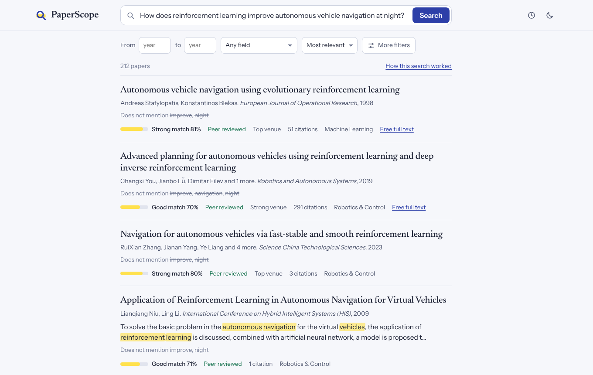
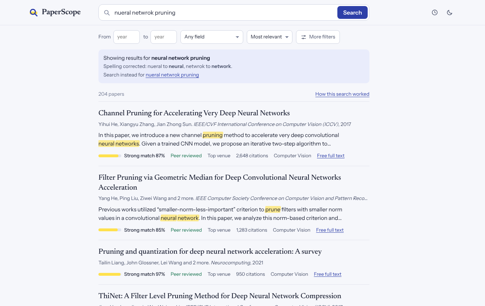
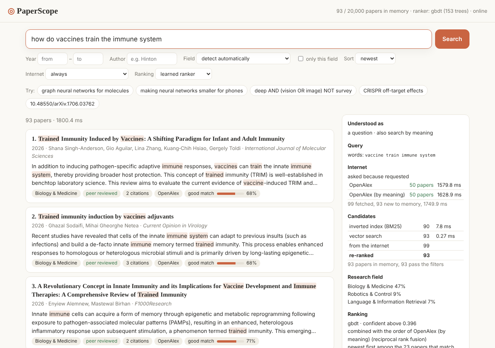

# PaperScope: research paper search

Type a topic in your own words, even as a sentence or with typos. PaperScope
first works out what you are looking for, then looks it up on **OpenAlex** (then
Semantic Scholar and Crossref if needed), keeps the papers it fetched in a small
in-memory index, and ranks them with a **learning-to-rank model** (gradient-boosted
trees, LambdaMART) that combines word match, meaning, research field, citations,
recency, peer review and venue quality.

* It understands everyday queries: "I want research papers on how to make
  neural networks smaller" is searched as "how to make neural networks smaller",
  "nueral netwrok pruning" as "neural network pruning", and "latest research on
  X" keeps the last five years. The page says what it searched for, with a link
  to search the words exactly as typed.
* Each result shows how well it matches your search (strong, good or partial,
  with a percentage), from the words it shares with your query and its meaning.
  Sorting by newest or most cited keeps the papers that match well first.
* Everything runs online: no paper database on your disk. Papers fetched in a
  session stay in memory (up to 20,000, least recently used forgotten first), so a
  second search on the same topic is answered without asking the internet again.
* The models were trained and tested on **real** papers with **real** relevance
  labels (citations), never on made-up data.
* Every hand-written data structure does a real job in the search: an inverted
  index, a vector index, an LRU cache (hash map + doubly linked list), an
  array-based stack for `AND / OR / NOT`, sorted-list merges and merge sort, a
  min-heap that picks the best candidates, a hash table (separate chaining) that
  merges duplicate papers, a binary search tree for year filters, and
  breadth-first search with a circular queue that finds related papers through
  citations (shown when you open a paper).

Why each design choice was made: [docs/DESIGN.md](docs/DESIGN.md).

## Setup

Python 3.9 or newer, and an internet connection.

```bash
cd paper-search
python -m venv .venv
source .venv/bin/activate            # Windows: .venv\Scripts\Activate.ps1  (see RUN_ON_WINDOWS.md)
python -m pip install -r requirements.txt
```

The trained models are already in `data/models/` (15 MB), so you can search right away.

## Search

Web app:

```bash
python app.py                                   # open http://127.0.0.1:5000
OPENALEX_API_KEY=your_key python app.py         # OpenAlex needs a free key (or put it in .env, see below)
OPENALEX_EMAIL=you@uni.edu python app.py        # your email in requests (polite pool for OpenAlex and Crossref)
S2_API_KEY=your_key python app.py               # optional Semantic Scholar key (shared pool is often busy)
PAPERSCOPE_CAPACITY=5000 python app.py          # keep at most 5,000 papers in memory
```

To avoid typing the key in every new terminal, copy `.env.example` to `.env`
in the paper-search folder and fill in `OPENALEX_API_KEY=...`. PaperScope reads
it on start. Keep `.env` to yourself: don't share it or put it in a zip you hand in.

The page shows the results and, next to them, how the search worked: which
words were used, whether the internet was asked and which provider answered,
how many candidates came from the inverted index and the vector index, the
detected research field, and the stack steps of a boolean query. Click a paper
to see why it ranked where it did (its nine feature values) and its related
papers: the papers in memory linked to it by citations, found by breadth-first
search (click one to open it).



Screenshots were taken against the live OpenAlex API, with a key: this one on
2026-10-19, and [docs/paper.png](docs/paper.png) (a paper with its related
papers) on 2026-10-22. See "Live test" below.

Command line (same pipeline):

```bash
python scripts/search.py "graph neural networks for molecules"
python scripts/search.py "CRISPR off-target effects" --field "Biology & Medicine" -k 5
python scripts/search.py "deep AND (vision OR image) NOT survey" --year-from 2018
python scripts/search.py "transformer attention machine translation" "attention transformers for translation"   # 2nd answered from memory
python scripts/search.py 10.48550/arXiv.1706.03762
python scripts/search.py "can you find me recent papers on nueral network pruning"   # understood, corrected
python scripts/search.py "papers on protein folding" --exact                          # words as typed
```

Query syntax: plain words; `AND` / `OR` / `NOT` in capitals with brackets;
`-word` to exclude; `optim*` for a prefix; a DOI, arXiv id or OpenAlex id (`W…`)
for one paper. Filters: year range, author, research field (favour it, or
`--strict-field` / "only this field" to keep nothing else), sort by relevance,
newest or most cited.

JSON API: `GET /api/search?q=...&exact=1&year_from=&year_to=&author=&field=&strict=1&sort=&page=&online=auto|always|never&mode=learned|hybrid|bm25|semantic`,
`GET /api/paper?key=doi:...`, `GET /api/suggest?prefix=...`, `GET /api/state`.

## How a search runs

1. **Understand** the query (`engine/understand.py`): fix typos with a spelling
   model learned from 600,013 real papers, drop request words ("find me papers
   on"), turn "recent" / "latest" into a year filter, and decide whether to also
   search by meaning (a sentence or question) or by title (a short phrase).
2. **Parse** it (`engine/pipeline.py`): words, exclusions, prefixes,
   identifiers; `AND / OR / NOT` go through the shunting-yard algorithm on a stack
   (`dsa/expression.py`).
3. **Memory first** (`engine/memindex.py`): the 200 best papers by BM25 from the
   inverted index, plus the 200 nearest by embedding, among the papers already in memory.
4. **Features and ranking** (`engine/features.py`, `engine/ranker.py`): nine
   features per candidate, scored by the gradient-boosted trees.
5. **Online when needed** (`engine/sources.py`): if fewer than 3 candidates are
   confident matches, ask OpenAlex → Semantic Scholar → Crossref (rate limits,
   timeouts, retries, a one-minute cool-down for a failing provider, answers
   cached in memory). At the same time, a sentence also goes to OpenAlex's
   search by meaning, and a short phrase to its title search (most cited
   first). New papers join the index and the ranking is redone; for a sentence
   it is combined with the by-meaning order (reciprocal rank fusion), and a
   well-cited paper whose title is the query goes first.
6. **Order** the results with merge sort (stable) and return one page.

## Understanding everyday queries

People rarely type clean keywords. A spelling model plus two extra OpenAlex
searches (by meaning, by title) close most of the gap, without a large language
model. Measured on 26 hand-written queries against live OpenAlex, each with a
fresh memory (`python scripts/check_queries.py`; `--exact` runs the old way):

| | before (v3.4) | now (v3.5) |
|---|---|---|
| right papers in the top 10 | 69% | 81% |
| first result is a right paper | 21 of 26 | 23 of 26 |
| the 3 queries with typos | no right paper | 10 of 10 right, each |
| "attention is all you need": the original paper | 8th | 1st |
| median time per new query | 1.0 s | 1.7 s |



The match next to each result counts the query words found in the paper, those
in its title, and closeness in meaning; citations and year are left out, so new
papers and filtered lists are not shown as weak. Measured on the same 26
queries with Internet set to "always", the median bar went from 38% to 76%, and
when sorting by newest from 1% to 77% (docs/PROJECT.md, section 13).



Every change is shown on the page ("Showing results for ...", the corrected
words, what was left out) and can be undone with "Search instead for" (the API's
`exact=1`, the command line's `--exact`). A new topic costs up to two more
OpenAlex requests; repeated searches come from memory.

## Train

```bash
python -m ml.train --online                 # papers, labels and candidates from the OpenAlex API
python -m ml.train --pool pool.jsonl        # from a sample of the OpenAlex snapshot (see below)
python -m ml.train --pool pool.jsonl --qrels my_judgments.tsv   # also test on your own judgments
```

Training does four things and saves the results in `data/models/`:

1. **Lexicon** (`engine/lexicon.py`): word statistics for BM25, TF-IDF + LSA
   embeddings (160 dimensions), and the research-field classifier, learned from
   real titles and abstracts.
2. **Labelled queries** (`ml/dataset.py`): for a real paper, the query is its
   title and the relevant papers are the ones it cites; the search is run as of
   the year it was written. Features are computed exactly as the app computes them.
   Split by query: 70% train, 10% validation, 20% test.
3. **Rankers** (`ml/lambdamart.py`): LambdaMART trees (early-stopped on
   validation NDCG@10) and a linear baseline, both calibrated to a probability of
   relevance.
4. **Evaluation** on the held-out test queries (`ml/evaluate.py`), written to
   `data/models/eval_report.json`.

If the OpenAlex API is not reachable, `python scripts/fetch_openalex.py pool.jsonl`
streams real works with their reference lists from the public OpenAlex snapshot
(free, CC0, no account) into a training file. The search app never reads it.

Your own relevance judgments, if you have them: a TSV file with
`query <tab> paper id <tab> grade` per line (paper id = DOI, arXiv id or OpenAlex
id; grade 0, 1 or 2), passed with `--qrels`.

## Live test (2026-10-19)

Everything was run against the real APIs from a cloud machine allowed to reach
api.openalex.org, api.semanticscholar.org and api.crossref.org.

| Part | Result |
|---|---|
| OpenAlex, no key | Refused: HTTP 429 "Insufficient budget. This request has no API key". Requests without a key share a small daily budget with everyone on the same network. |
| OpenAlex, free key | Works. Each request costs $0.001 of the key's $1/day (about 1,000 requests a day); a new topic is one request. |
| Crossref | Works without a key (about 0.3 to 1.3 s). Used automatically when OpenAlex fails. |
| Semantic Scholar | Mostly HTTP 429 without a key (shared pool busy); some lookups went through. Optional `S2_API_KEY`. |
| Web app | Search, suggestions, paper details and the side panel all work in Chromium, no browser errors. |
| Online search | About 46 to 50 real papers per new topic in about 0.9 to 1.3 s with OpenAlex. A related second query ("graph neural network molecular property" after "graph neural networks for molecules") was answered from memory in 32 ms with no network call. |
| Paper lookup | DOI 10.1038/nature14539 ("Deep learning", Nature 2015), arXiv 10.48550/arXiv.1706.03762 ("Attention Is All You Need") and OpenAlex id W2741809807 ("The state of OA", PeerJ 2018) all found. |
| Unit tests | 60 pass (`python -m unittest`, no network). |
| `python -m ml.train --online --queries 200` | Runs end to end in about 1 minute (cost about $0.06). Only about 1 in 7 live citation queries finds one of the seed paper's cited papers in its top 100, so 200 queries gave just 12 usable training queries. That is far too few to beat the shipped models (3,177 training queries from `--pool`), which were kept. A useful online retrain needs several thousand queries, spread over a few days of the key's budget. |

What was fixed after testing live:
* A refusal that asks to wait hours (OpenAlex's used-up budget sends Retry-After of
  about 16 h) used to be retried until the search deadline ran out, so Crossref
  never got its turn and every search returned 0 papers. Now the provider is
  skipped at once and not asked again until the wait is over (at most 6 h), and
  every later provider keeps 1.5 s of the deadline for itself.
* OpenAlex finds "Attention Is All You Need" by its arXiv DOI, but lists another
  DOI as the paper's main one, so the lookup threw the answer away. A one-DOI
  lookup now accepts the single work OpenAlex returns.
* Crossref records that are not papers (figures, peer reviews, journal issues)
  are dropped, and a record without a publication date takes its DOI
  registration year.
* Looking up a DOI falls back to Crossref when OpenAlex and Semantic Scholar fail.
* The web page and the command line show why an id lookup found nothing, and
  online training explains how to get an OpenAlex key instead of crashing.
* API keys can live in a `.env` file instead of being typed in every terminal.

## Results of the shipped models

Trained on 600,013 real OpenAlex works (streamed from the public snapshot with
`--pool`, because the OpenAlex API was not reachable when the models were built) with 6,000 citation
queries: 3,177 for training, 460 for validation, **1,199 held-out test queries**.
Every system re-ranks the same ~185 candidates per query.

| System | NDCG@10 | MRR | P@10 | R@50 | in-field@10 |
|---|---|---|---|---|---|
| BM25 only | 0.139 | 0.244 | 0.058 | 0.288 | 0.798 |
| Embeddings only | 0.025 | 0.050 | 0.011 | 0.074 | 0.615 |
| Hand-set weights (no training) | 0.145 | 0.258 | 0.058 | 0.278 | 0.796 |
| Linear learned ranker | 0.228 | 0.377 | 0.093 | 0.369 | 0.797 |
| **Gradient-boosted trees (shipped)** | **0.240** | **0.394** | **0.096** | **0.369** | **0.798** |

How to read it:

* The learned ranker puts a cited paper first or second far more often than word
  matching alone: MRR 0.39 against 0.24, and NDCG@10 up by 72%.
* Absolute numbers look low because citation labels under-count relevance (an
  author cites a few of the many relevant papers), 297 of the 1,199 test queries
  have no cited paper among their candidates at all, and recall counts every
  cited paper in the pool. These limits are the same for every system.
* What the trees rely on most: citations per year (28%), BM25 (24%), embedding
  similarity (13%), field match (12%).
* Embeddings alone rank poorly here: a short title is a weak query for an LSA
  embedding, so the nearest neighbours are on the general topic but rarely the
  papers that were cited. They still help as a feature and as a source of
  candidates that share no words with the query.
* The research-field classifier is 76% accurate (macro-F1 0.72) on 40,000
  held-out papers across 13 fields, against 30% for always guessing the largest field.

## Speed and memory

Measured over 3,000 searches (paper titles used as queries) with the memory
limit at 20,000 papers. The internet was replaced by a local stand-in that
answers from 200,000 real OpenAlex papers, so these times **leave out network
time**; a real OpenAlex call usually adds a few hundred milliseconds.

| | Result |
|---|---|
| Search answered from memory (median) | 32 ms |
| Search from memory with all 20,000 papers held (mean) | 34 ms |
| Search that went online (median, without network time) | 287 ms |
| Searches answered from memory | 453 of 3,000 (each new topic goes online once) |
| Papers held at the end / postings in the inverted index | 20,000 / 1,377,731 |
| Extra process memory for 20,000 papers | about 290 MB |

Since v3.2 (see [docs/PROJECT.md](docs/PROJECT.md), Part 2) three data
structures changed: at 20,000 papers a search from memory takes about 40 ms
instead of 62 to 70 ms, and adding the 50 papers of an online search takes 75 to
92 ms instead of 392 to 465 ms (measured on 20,000 real OpenAlex works, network
time excluded). v3.3 also stopped scoring each search twice (about 30 ms per
search from memory in a later run). v3.4 replaced numpy's partial selection and
Python's dict with the hand-written heap and hash table and added the year tree:
on 11,866 papers a search from memory takes 20.9 ms instead of 14.6 ms. The table
above is from the earlier version.

Memory stops growing at the limit: the least recently used papers are dropped
and the index is compacted, so search time stays flat as the session goes on.

## Documentation

* [docs/PROJECT.md](docs/PROJECT.md): the whole project (purpose, architecture,
  modules, data structures, setup, limitations) and the data structure analysis
  with worked examples (`python scripts/ds_examples.py` reproduces them).
* [docs/DESIGN.md](docs/DESIGN.md): design notes and what was removed.

## Tests

```bash
python -m unittest -v
```

89 tests, no internet needed (a fake HTTP transport stands in for the APIs):
the data structures (heap, hash table, queue, BFS and year tree included), the in-memory index (BM25 against its formula, eviction,
compaction), the online sources (cascade, cache, cool-down, deadline), query
understanding (spelling, request words, recency, fusion), the pipeline end to end, LambdaMART, and the web API.

## Project layout

```
app.py                 web app (Flask) and JSON API
engine/
  pipeline.py          the search: understand, parse, memory, online, rank
  understand.py        query understanding: spelling, request words, recency
  memindex.py          in-memory inverted index + vector index with LRU eviction
  sources.py           OpenAlex / Semantic Scholar / Crossref client, in-memory cache
  lexicon.py           word statistics, embeddings, field classifier (learned once)
  features.py          the nine ranking features
  ranker.py            gradient-boosted trees, linear and hand-set rankers (JSON)
  metadata.py          citations, recency, peer review, venue quality signals
  domains.py           the 13 research fields
  papers.py            one paper record format for every source
  text.py              tokeniser, stop words, stemmer
dsa/
  stack.py             array-based stack
  expression.py        AND / OR / NOT: infix -> postfix -> evaluation
  merge.py             merge of sorted lists, merge sort
  lru.py               LRU cache with expiry
  heap.py              binary min-heap, top-k selection
  hashtable.py         hash table (separate chaining) for paper identity keys
  bst.py               binary search tree keyed by year (year filter)
  queue.py             circular queue
  graph.py             breadth-first search (related papers)
ml/
  train.py             builds every model and evaluates it
  dataset.py           real citation labels (online, pool, or your judgments)
  lambdamart.py        LambdaMART, linear baseline, calibration
  evaluate.py          NDCG@10, MRR, P@10, R@50, in-field@10
  metrics.py           the metric formulas
scripts/
  search.py            command-line search
  fetch_openalex.py    training papers from the OpenAlex snapshot
  ds_examples.py       the worked data structure examples in docs/PROJECT.md
  check_queries.py     26 everyday queries against live OpenAlex (search quality)
static/                the web page
data/models/           the trained models (the only files the app reads)
tests/                 unit tests
```

## What changed from the previous version

**Removed** (details in [docs/DESIGN.md](docs/DESIGN.md#what-was-removed-and-why)):
every sort except merge sort; linear, indexed and Fibonacci search; the
linked-list stack (the array stack stays); linked lists, queues, deque and the
Josephus problem; address calculation and the demo sparse-matrix and
dynamic-array classes; the DSA Lab page, search history, recently viewed and
featured papers; the bundled hand-written sample papers and judgments; local
data files, the SQLite cache and saved external papers; the optional
sentence-transformers embedder.

**Kept and reused:**

* `engine/text.py` (tokeniser, stop words, stemmer), unchanged.
* `engine/sources.py`: the rate limiter, the HTTP layer (timeouts, retries,
  backoff, Retry-After), the three providers and the cascade with cool-down. The
  SQLite cache became an in-memory LRU cache; OpenAlex answers now carry venue
  rankings, topics and publication status.
* `engine/domains.py`: the 13 fields and the arXiv-category and OpenAlex-topic
  mappings; the classifier was rebuilt on TF-IDF from the lexicon.
* `engine/metadata.py`: the citation, recency and venue-quality signals.
* `dsa/stack.py` (the array stack), `dsa/expression.py` (shunting-yard and
  postfix evaluation for boolean queries), `dsa/merge.py` (the sorted-list merge
  and merge sort).
* `ml/metrics.py` (NDCG, MRR, precision, recall), the BM25 formula, the query
  syntax, the look of the web page, and the fake HTTP transport used by the tests.

**New:** the in-memory index with LRU eviction, the lexicon learned from real
papers, nine features including publication metadata, LambdaMART, citation-based
labels, and the online-first pipeline.
